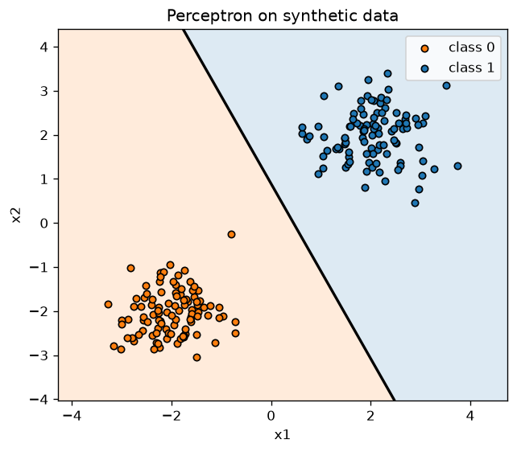
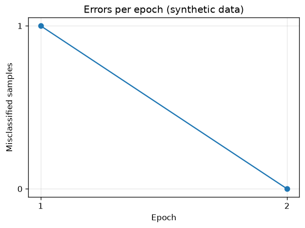
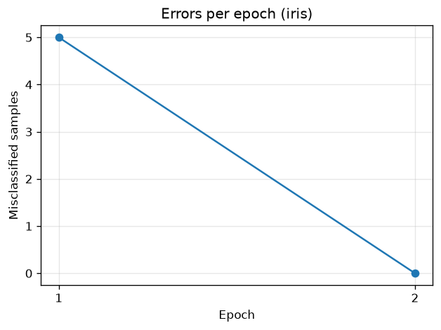

# Perceptron Lab

Лабораторная работа 1 по курсу Python (трек Data Science, тема А1).
Однослойный перцептрон для бинарной классификации, реализованный вручную на `numpy`.

## Что делает программа

Перцептрон получает точку с признаками `x`, считает взвешенную сумму
`z = w·x + b` и переводит её в класс ступенчатой функцией: `1`, если `z >= 0`, иначе `0`.
Обучение идёт по правилу перцептрона: при ошибке веса сдвигаются как
`w += lr · (target − pred) · x`, `b += lr · (target − pred)`.

Программа:

1. генерирует два линейно разделимых облака точек вокруг центров `(-2, -2)` и `(2, 2)`;
2. обучает на них перцептрон и печатает точность;
3. сохраняет график границы решения и график ошибок по эпохам;
4. с флагом `--iris` проверяет модель на реальных данных: iris, setosa против versicolor,
   с разбиением 70/30 на обучающую и тестовую части.

Перцептрон сходится только на линейно разделимых данных: на AND он обучается
до точности 1.0, на XOR не сходится. Оба случая проверяются тестами.

## Структура

```
perceptron.py              # точка входа: python perceptron.py ...
perceptron_lab/
    __init__.py            # экспорт Perceptron
    model.py               # класс Perceptron
    data.py                # генератор синтетических данных
    plots.py               # графики: граница решения, ошибки по эпохам
    iris.py                # загрузка iris и train/test split
    cli.py                 # разбор аргументов (argparse) и запуск
tests/                     # тесты pytest
docs/images/               # примеры графиков для README
.github/workflows/ci.yml   # CI: ruff, mypy, pytest на каждый push
pyproject.toml             # зависимости и настройки ruff, mypy, pytest
uv.lock                    # точные версии зависимостей
```

## Установка

Нужен [uv](https://docs.astral.sh/uv/). Окружение и зависимости ставятся одной командой:

```bash
uv sync
```

## Запуск

```bash
uv run python perceptron.py --samples 200 --lr 0.1 --epochs 50
```

```
Synthetic data: 200 points, 2 features
Epochs used:    2 of 50
Accuracy:       1.000
Plots saved:    plots\decision_boundary.png, plots\errors.png
```

Проверка на iris:

```bash
uv run python perceptron.py --iris
```

```
Iris: setosa vs versicolor, 70 train / 30 test samples
Epochs used:    2 of 50
Train accuracy: 1.000
Test accuracy:  1.000
Plot saved:     plots\iris_errors.png
```

Вместо `python perceptron.py` можно писать `uv run perceptron`.

| Аргумент | По умолчанию | Смысл |
|---|---|---|
| `--samples` | 200 | число сгенерированных точек |
| `--lr` | 0.1 | скорость обучения |
| `--epochs` | 50 | максимум эпох |
| `--seed` | 42 | seed генератора случайных чисел |
| `--plots-dir` | `plots` | папка для графиков |
| `--iris` | выкл. | проверка на iris вместо синтетических данных |

Неверные аргументы дают понятное сообщение вместо трейсбека:

```
perceptron: error: argument --lr: expected a positive number, got -1.0
```

## Графики

Граница решения на синтетических данных и ошибки по эпохам:





Ошибки по эпохам на iris:



## Тесты и проверки качества

```bash
uv run pytest -v            # тесты
uv run ruff check           # линтер
uv run ruff format --check  # форматирование
uv run mypy                 # проверка типов (strict)
```

Те же проверки запускаются в GitHub Actions на каждый push (`.github/workflows/ci.yml`).
